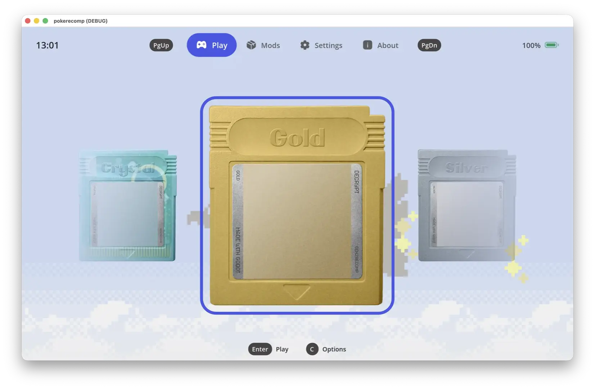

<p align="center">
  
</p>

<p align="center">
  
  
  
  
  <a href="https://github.com/Decryptu/pokerecomp/releases/latest"></a>
  <a href="LICENSE"></a>
  <a href="https://discord.gg/twkrHkHprk"></a>
  <a href="https://x.com/DecryptTV"></a>
</p>

A native [Godot 4](https://godotengine.org) reimplementation of the Game Boy
Pokémon games. Gold, Silver, Crystal, Red, Blue and Yellow are playable from the
bedroom to the Hall of Fame and their own credits. It is written from
scratch in GDScript, not an emulator, static recompilation or disassembly. A
user-supplied cartridge dump is SHA-1 verified, decoded once into a cache, then
released. No game data ships here: bring your own ROM.

## Download

**[Latest release](https://github.com/Decryptu/pokerecomp/releases/latest)** ships
one file per platform. `sha256sums.txt` covers every one of them.

| You have | File |
|---|---|
| Windows | `pokerecomp-<version>-windows-x86_64.exe` |
| Windows on ARM | `pokerecomp-<version>-windows-arm64.exe` |
| macOS | `pokerecomp-<version>-macos.zip` |
| Linux | `pokerecomp-<version>-linux-x86_64` |
| Linux on a Pi, an SBC or an ARM handheld | `pokerecomp-<version>-linux-arm64` |
| Android, handhelds included | `pokerecomp-<version>-android.apk` |
| iPhone or iPad | `pokerecomp-<version>-ios.ipa` |
| Nintendo Switch running homebrew | `pokerecomp-<version>-switch.zip` |

Nothing is signed with a paid certificate, so each platform asks once:

- **Windows**: *More info*, then *Run anyway*.
- **macOS**: right-click the app, *Open*, then *Open* again.
- **Linux**: `chmod +x` the file, then run it.
- **Android**: allow installing from this source.
- **iOS**: the `.ipa` is deliberately **unsigned**. Install it with
  [AltStore](https://altstore.io) or [SideStore](https://sidestore.io), which
  sign it on your own machine with your own Apple ID. A free Apple ID works and
  needs re-signing weekly. Add this source to either one and every release
  arrives as an update:

  ```
  https://raw.githubusercontent.com/Decryptu/pokerecomp/main/.github/altstore/source.json
  ```
- **Switch**: extract the zip at the root of your microSD and launch
  `pokerecomp` from the homebrew menu. It needs a console that already runs
  homebrew; nothing here installs one.

The About page tells you when a newer release exists. It does not install it:
download the new file and replace the old one. Saves live elsewhere and survive.

<p align="center">
  
</p>

## Getting started

Use Godot 4.8 or newer. Enable the cartridge-data and release checks:

```bash
git config core.hooksPath .githooks
```

Put supported dumps in `roms/` ([instructions](roms/README.md)), then run:

```bash
godot --headless --path . -s res://tools/verify_rom.gd
godot --headless --path . -s res://tools/import_rom.gd
godot --path .
```

Identity is checked by SHA-1 against [RomRegistry](game/rom/rom_registry.gd),
never by filename. Unknown revisions are refused. The launcher also accepts
imports through its file picker or by dropping a dump onto a cartridge bay.

Caches live in Godot's `user://`. A format update requires reimporting the same
dump; saves are separate and survive. `--verify` checks an import without writing.

Generation 3 is experimental and **not playable**. Settings > Advanced > Dev
cartridges exposes Ruby, Sapphire, FireRed, LeafGreen and Emerald; command-line
imports require `--dev`. See [current work](game/gen3/) for the implementation.

## Playing

Play opens the save-slot screen. New Game runs the original opening; Continue
restores the last save. Slots support naming, editing, import and export.
Generation 1 `.sav` imports carry the whole game; Generation 2 imports carry
player and party only. See [save compatibility](docs/SAVES.md).

Choose a mode when creating a slot; it is fixed for that run:

| Mode | Rules |
|---|---|
| Vanilla | Original cartridge rules |
| Hard | All trainer AI layers, teams 15% higher, perfect DVs and full stat experience |
| Nuzlocke | First encounter per area, mandatory nicknames, permanent fainting, wipe ends the run |

Nuzlocke deaths and claimed encounters persist immediately. Ordinary gameplay
persists through SAVE; closing without saving discards later progress.

### Controls

| Button | Keyboard | Controller |
|---|---|---|
| Directions | Arrows, WASD | D-pad, left stick |
| A | Z, Space | Bottom face button |
| B | X, Escape | Right face button |
| START | Enter | Start |
| SELECT | Backspace, Tab | Back |

Bindings use physical key positions and can be changed in Settings. Touch
controls appear on touch; three quick taps restore them. A+B+START+SELECT
resets to the save screen without saving; the first reset asks for confirmation.

### Display and sound

Settings > Application controls screen fill, zoom, window mode, scrolling,
game speed and frame rate. Fill extends the map around the original 160x144
interface; Framed keeps the hardware rectangle. Connected maps are scenery:
only the current map runs gameplay. Use +/-, the wheel, or 0 to reset zoom.

Smooth scrolling interpolates movement without changing game timing. Game speed
changes gameplay timing while audio keeps its original pitch and tempo. Display
frame rate follows the panel; lower caps can save battery.

Settings > Second screen opens read-only party, bag, map, Pokédex and trainer
pages on a second display or desktop window. Availability follows the same gates
as the game's start menu.

## Mods

Install and manage mods from the launcher's Mods tab. Mods are interpreted
GDScript. [The mod guide](docs/MODS.md) covers authoring and public APIs;
[examples](mods/examples/) demonstrate content and renderer mods.

## Tools

Use a tool only for the subject being investigated. `tools/validate.gd` lists
cartridge-check topics when called without arguments; select a topic rather
than `all` for routine work. Arguments and preview options live in each script.

| Tool | Purpose |
|---|---|
| [validate.gd](tools/validate.gd) | Checks against imported cartridges |
| [dump_tables.gd](tools/dump_tables.gd) | Decoded tables |
| [preview_pics.gd](tools/preview_pics.gd) | Sprite contact sheets |
| [preview_world.gd](tools/preview_world.gd) | Map previews |
| [preview_world_story.gd](tools/preview_world_story.gd) | Scripted story routes |
| [replay_world.gd](tools/replay_world.gd) | Deterministic input replay |
| [render_audio.gd](tools/render_audio.gd) | WAV and register traces |
| [screenshot.gd](tools/screenshot.gd) | Scene capture; requires a window |
| [record_clip.gd](tools/record_clip.gd) | Scripted video capture |
| [profile.gd](tools/profile.gd) | Frame costs; requires a window |

## Tests

[GUT](https://github.com/bitwes/Gut) is in `addons/gut`. Tests use synthetic
files, never a real cartridge. Run affected tests with the shared local/CI command:

```bash
python3 tools/test.py --base origin/main
```

Use `--list` to preview selection, pass a test file to run that subject, and use
`--full` for the complete suite. Add `--import` after introducing scripts.
PR CI checks affected consumers; `main` checks everything. The
[verification policy](docs/CONTRIBUTING.md#verifying) defines when engine tests,
visual inspection and cartridge checks are appropriate.

## Development and exports

Feature scripts and scenes live together in `game/`; `autoload/` owns singletons,
`tests/` owns synthetic fixtures and screen tests, and `tools/checks/` owns
cartridge checks. Third-party code lives in `addons/`.

Install matching export templates, then use a preset from `export_presets.cfg`:

```bash
godot --headless --path . --export-release "Linux" builds/linux/pokerecomp.x86_64
```

[Release automation](.github/workflows/release.yml) builds all platforms from a
`v*` tag. [Template builds](.github/workflows/export-templates.yml) own engine
pins and platform setup. Android needs `tools/build_android_plugin.sh` and the
Android build template. Switch uses its fork's template and pack wrapping rather
than a stock editor preset. iOS releases are unsigned for sideloading.

## Reporting a bug

The launcher's About page has a **Report a bug** button. Either route works:

- [Open an issue](https://github.com/Decryptu/pokerecomp/issues/new)
- [Ask on Discord](https://discord.gg/twkrHkHprk)

Say which cartridge, where you were and what you did. A screenshot settles most
of it.

The same sheet has **Save a report file**, which writes one `.zip` to your
downloads folder. It holds the build, your machine, your settings, your installed
mods and the last few session logs, and nothing else: no save data, no other file
from your computer. **Copy the details** is the same thing without the logs, for
a chat message. Attach the file if the game crashed or looked wrong.

The launcher tells you at the next launch when a session did not shut down
cleanly. Logs live under `logs/` beside your saves:
`%APPDATA%\Godot\app_userdata\pokerecomp` on Windows,
`~/Library/Application Support/Godot/app_userdata/pokerecomp` on macOS,
`~/.local/share/godot/app_userdata/pokerecomp` on Linux. Old ones are deleted as
new ones arrive.

## Contributing

Read [docs/CONTRIBUTING.md](docs/CONTRIBUTING.md). No cartridge-derived data may
enter the repository: no ROM, `.sav`, extracted sprites, text, maps or audio.
`.gitignore`, the pre-commit hook and tests enforce this; do not weaken them.
For reproducible comparisons with the upstream disassemblies, see
[docs/REFERENCES.md](docs/REFERENCES.md).

## Licence

[MIT](LICENSE) covers the engine source here, not the games or supplied dumps,
which remain the property of their respective owners.
